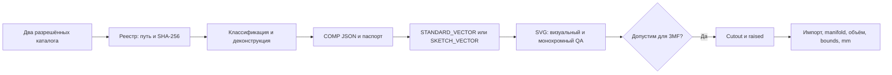

# SVG Builder

Детерминированный конвейер: разрешённый растр → классификация → паспорт → монохромный SVG → проверяемые cutout/raised 3MF.


## Актуальный набор

Единственные активные исходники — **56 изображений**: 55 в
`01_input_raster/complex_gradients/` и одно в `01_input_raster/high_contrast/`.
Категории — расположение исходников, а не обещание конкретного режима векторизации.
Наличие файла, канонический относительный путь и SHA-256 определяют его идентичность.

[Реестр исходников](reference-whitelist.json) содержит размеры, форматы, хеши,
COMP ID, паспорта и связи с результатами. Все 56 SVG прошли автоматические
quality gates в проверенном окружении. Это не утверждение о ручной визуальной
приёмке всех изображений или печати всех 3MF.

Исходники и производные разрешены владельцем к публикации 2026-11-19.
Полный локальный разрешённый набор включён в публичный репозиторий.
Условия использования: [ASSET_RIGHTS.md](ASSET_RIGHTS.md).

## Установка и воспроизведение

Проверенное окружение: Python 3.10.11. Активному runtime не нужны GPU, StarVector,
PyTorch, сетевые модели или API-ключи.

```powershell
git clone https://github.com/indexdeny/svg_builder.git
cd svg_builder
python -m venv .venv
.venv\Scripts\python -m pip install -r requirements.txt
.venv\Scripts\python ops/scripts/reference_whitelist.py
.venv\Scripts\python ops/scripts/deconstruct.py
.venv\Scripts\python ops/scripts/validate.py
.venv\Scripts\python ops/scripts/compile_svg.py
.venv\Scripts\python ops/scripts/compile_3mf.py
.venv\Scripts\python ops/scripts/validate_dataset.py --refresh-links
```

Команды выполняются из корня проекта. `compile_3mf.py` возвращает ненулевой код,
если вариант не прошёл геометрические ограничения. Диагностика находится в
`07_output_3mf/quarantine/*.failure.json`; это не существующая 3D-модель.
Проверка `validate_dataset.py` отдельно оценивает целостность набора: корректно
зафиксированный отказ генерации не является потерянной ссылкой.

Конвейер не читает старую папку входов и не изменяет разрешённые оригиналы.
При изменении состава или байтов исходников он прекращает обработку.
После разрешённого изменения набора сначала проверить состав, затем выполнить
`python ops/scripts/reference_whitelist.py --refresh` и пересобрать результаты.

## Архитектура и контракты



SSOT: [pipeline_config.json](00_governance/pipeline_config.json).
Активный цвет — чёрный на прозрачном фоне. STANDARD_VECTOR использует SSIM ≥0.93
относительно сегментированной маски, SKETCH_VECTOR — SSIM ≥0.75 относительно
маски линий. Эти метрики не измеряют узнаваемость или совпадение с цветным растром.
Замкнутость, отсутствие растра/градиентов и режим определяют 3MF eligibility;
SKETCH_VECTOR не допускается к экструзии.

Схемы: [паспорт](00_governance/schemas/passport_schema_v1.json),
[SVG artifact](00_governance/schemas/svg_artifact_v1.schema.json),
[mesh artifact](00_governance/schemas/mesh_artifact_v1.schema.json).
Подробнее: [архитектура](docs/ARCHITECTURE.md) и [аудит lineage](REFERENCE_LINEAGE_AUDIT.md).

## Проверки

```powershell
python -m unittest discover -s ops/tests -p test_reference_whitelist.py
python ops/tests/test_svg_cad.py
python ops/tests/test_compile_3mf.py
python ops/scripts/validate.py --artifacts
python ops/scripts/validate_dataset.py
python ops/scripts/smoke_check.py
```

Последняя команда создаёт отдельный временный проект с двумя явно синтетическими
геометрическими fixtures и проходит весь pipeline до четырёх 3MF. Эти fixtures
проверяют алгоритмы и не добавляются в набор владельца.

## Ограничения

- Автоматический SVG QA не заменяет визуальную оценку.
- Не каждый успешный SVG допускается к 3MF.
- Профиль 3MF: длинная сторона 500 мм; габарит принтера 550×450×450 мм.
  Часть вариантов не проходит ограничения габаритов или manifold-проверку.
  Масштаб и пороги не снижались ради увеличения числа результатов.
- Cutout и raised проверяются независимо; файл публикуется только после
  проверки экспортированного 3MF повторным импортом.
- Детерминированный выбор алгоритма не означает побайтовую идентичность
  результатов на всех версиях библиотек и машинах.
- История Git не переписывалась. Исключённые данные могут оставаться в старых
  коммитах и других ветках; это отдельная задача history remediation.
- Исторические нейронные и вспомогательные модули сохранены, но не входят в
  текущий маршрут компиляции по умолчанию.

Точные замеры, проверка backup, результаты тестов и состояние публикации:
[FINAL_REFERENCE_CLEANUP_REPORT.md](docs/audits/FINAL_REFERENCE_CLEANUP_REPORT.md).
